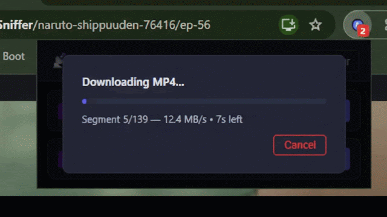
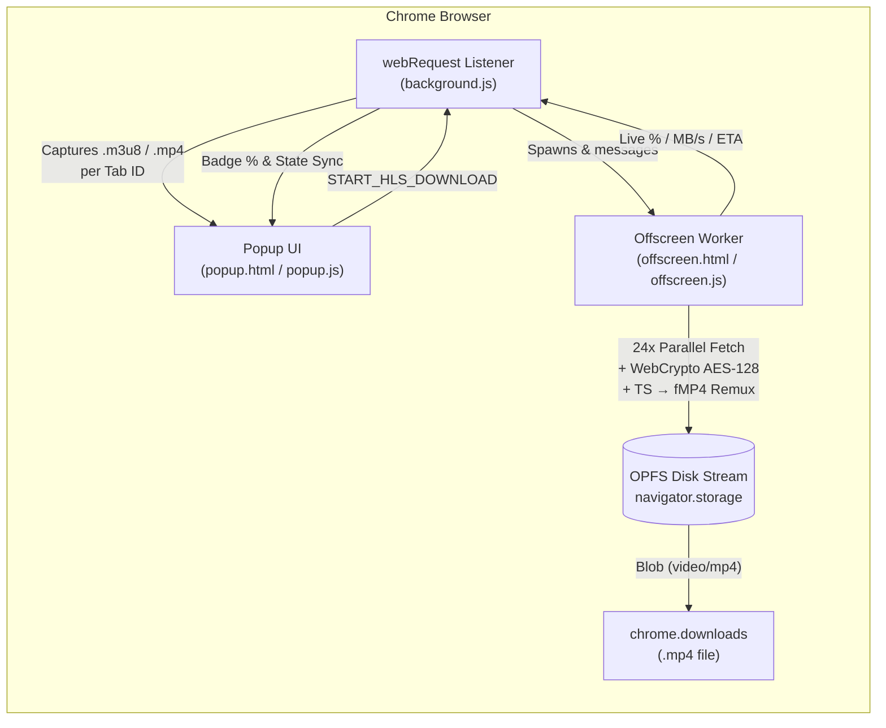

# 📡 StreamSniffer

**A high-performance Chrome Extension (Manifest V3) for real-time media stream detection, AES-128 HLS decryption, and in-browser MPEG-TS to Fragmented MP4 (`fMP4`) remuxing.**


<p align="center">
  
</p>

---

## 📖 Overview

Modern web video players rarely serve a single static `.mp4` file. Instead, they use **HTTP Live Streaming (HLS)** with adaptive bitrate playlists (`.m3u8`), split audio and video into **separate demuxed tracks**, encrypt segments using **AES-128-CBC**, and package media inside raw **MPEG-TS** transport stream chunks.

**StreamSniffer** solves this completely inside the browser with **zero external dependencies or companion desktop apps**:
1. **Passive Network Interception:** Listens to browser network headers (`chrome.webRequest`) per tab to detect progressive media (`.mp4`, `.webm`) and HLS playlists (`.m3u8`) in real time.
2. **Smart Track Discovery & Master Playlist Resolution:** Automatically resolves master playlists, selects the highest-bandwidth video variant, and pairs separated audio/video renditions (`#EXT-X-MEDIA:TYPE=AUDIO`) even when only a single sub-playlist was captured.
3. **Client-Side AES-128 Decryption:** Uses the native **Web Crypto API** (`crypto.subtle`) to pre-fetch keys, derive segment Initialization Vectors (explicit or sequence-based), and decrypt segments in memory at native speed.
4. **Custom In-Browser MPEG-TS → Fragmented MP4 (`fMP4`) Remuxer:** Demuxes H.264 Annex-B NAL units (`SPS`, `PPS`, `IDR`, non-IDR slices) and AAC ADTS audio frames from MPEG-TS packets, orders video frames by Decoding Timestamp (`DTS`) with signed Composition Time Offsets (`CTS = PTS - DTS`), and writes standard ISO Base Media File Format boxes (`ftyp`, `moov`, `moof`, `mdat`).
5. **Zero-RAM Disk Streaming via OPFS:** Streams remuxed MP4 fragments directly to the **Origin Private File System (OPFS)** inside a persistent Chrome **Offscreen Document**, allowing multi-gigabyte downloads without hitting V8 memory limits or terminating when the popup closes.

---

## ✨ Key Features

- **Manifest V3 Offscreen Architecture:** Downloads run inside a dedicated `offscreen` document so you can close and reopen the extension popup freely while tracking live `%` progress on the toolbar badge.
- **24-Worker Sliding-Window Concurrency:** Downloads and decrypts up to 24 audio+video segment pairs in parallel with automatic exponential-backoff retries, while writing output strictly in sequential order.
- **Built-In ISO BMFF (`fMP4`) Engine:** Outputs universally playable `.mp4` files (H.264 `avc1` + AAC `mp4a`) compatible with Windows Media Player, QuickTime, VLC, and HTML5 `<video>`.
- **Zero-Footprint OPFS Storage:** Eliminates `RangeError: Array buffer allocation failed` on 1 GB+ videos by flushing each remuxed fragment directly to disk.
- **Live Telemetry UI:** Clean 400px dark-mode popup displaying detected stream types, live transfer speed (`MB/s`), and estimated time remaining (`ETA`).

---

## 🏗️ Architecture Overview



### File Breakdown

| File | Responsibility |
| :--- | :--- |
| `manifest.json` | Manifest V3 configuration declaring `webRequest`, `downloads`, `storage`, `offscreen`, and host permissions. |
| `background.js` | Service Worker that intercepts media requests per tab, manages the `offscreen` document lifecycle, updates the toolbar badge (`%`), and triggers `chrome.downloads.download`. |
| `offscreen.html` / `offscreen.js` | Persistent background worker housing the **24-worker sliding-window downloader**, **Web Crypto AES-128 decryptor**, **`FMP4Muxer` ISO BMFF engine**, and **OPFS disk writer**. |
| `popup.html` / `popup.css` / `popup.js` | Reactive dark-mode UI that displays detected streams, starts/cancels downloads, and reconnects to live download progress whenever opened. |

---

## 🛠️ Engineering Challenges & Solutions

Building a production-grade HLS downloader and multiplexer inside pure browser JavaScript exposed five major systems-engineering challenges:

### 1. Demuxed Audio-Only vs. Video-Only Streams
- **Problem:** Many streaming CDNs separate audio (`/audio/eng/index.m3u8`) and video (`/720p/index.m3u8`) into independent playlists. If the user opens the extension mid-stream, the network sniffer often captures only the audio sub-playlist or a single video rendition, resulting in silent video or audio-only downloads.
- **Solution:** Implemented `resolvePlaylistTracks()` in `offscreen.js`, which cross-references sibling streams captured on the active tab, probes parent directory paths for master playlists (`index.m3u8`, `master.m3u8`), parses `#EXT-X-MEDIA:TYPE=AUDIO` group bindings, and pairs the highest-bandwidth video variant with its companion audio track.

### 2. V8 Heap Exhaustion (`Array buffer allocation failed`) on Large Videos
- **Problem:** Accumulating 600+ decrypted HD video segments (1.3 GB+) in memory inside an array of `ArrayBuffer`s before creating a `Blob` crashes the extension process with `RangeError: Array buffer allocation failed`.
- **Solution:** Replaced in-memory buffering with the **Origin Private File System (OPFS)** API (`navigator.storage.getDirectory()`). Each segment is decrypted, remuxed into an `fMP4` fragment (`moof` + `mdat`), and flushed directly to disk via `FileSystemWritableFileStream.write()`, keeping RAM usage under ~25 MB regardless of video length.

### 3. H.264 B-Frame Reordering (`PTS` vs. `DTS`) & Missing Video Picture
- **Problem:** In H.264 High Profile streams containing bidirectional frames (**B-frames**), the Presentation Timestamp (`PTS`) order differs from the Decoding Timestamp (`DTS`) order. An earlier iteration sorted MPEG-TS packets by `PTS` to interleave audio and video, which placed B-frames in the bitstream *before* the reference P-frames they depended on and broke 4-bit MPEG-TS Continuity Counters (`CC`). Hardware decoders rejected the video track entirely, playing only audio.
- **Solution:** Built `FMP4Muxer` in `offscreen.js` to reassemble full PES packets, sort video access units strictly by **Decoding Timestamp (`DTS`)**, and encode the presentation difference (`CTS = PTS - DTS`) into version-1 ISO BMFF Track Run (`trun`) boxes alongside 64-bit `tfdt` decode timestamps.

### 4. Browser MIME Sniffing & Raw `.ts` Container Incompatibility
- **Problem:** Raw MPEG-TS (`.ts`) files lack a global container header and often fail to open in Windows Media Player or QuickTime. Additionally, creating an untyped object URL from an OPFS file handle caused Chrome's download manager to sniff the binary header as `text/plain` and save the video with a `.txt` extension.
- **Solution:** Instead of outputting raw MPEG-TS, the extension now remuxes the elementary H.264 Annex-B NAL units (converting start codes to 4-byte AVCC length prefixes and extracting `SPS`/`PPS` into an `avcC` configuration box) and AAC ADTS frames (extracting `AudioSpecificConfig` into an `esds` descriptor) into a standard **Fragmented MP4 (`.mp4`)** container wrapped in an explicit `new Blob([finalFile], { type: "video/mp4" })`.

### 5. Manifest V3 Popup Closure & Service Worker Idle Timeouts
- **Problem:** Running downloads inside `popup.js` aborts the download the moment the user clicks outside the popup. Moving the download into `background.js` (Service Worker) helps, but Chrome terminates MV3 Service Workers after ~30 seconds of inactivity, and Service Workers lack `URL.createObjectURL()`.
- **Solution:** Adopted Chrome's `chrome.offscreen` API (`offscreen.js`) paired with a 24-worker sliding-window download pool. The offscreen document persists independently of the popup, streams at full bandwidth with live `MB/s` and `ETA` telemetry, creates the `video/mp4` Blob URL upon completion, and hands it to `background.js` to trigger `chrome.downloads.download` automatically—even while the popup is closed.

---

## 🚀 Installation (Developer Mode)

You can load **StreamSniffer** unpacked in Google Chrome, Microsoft Edge, Brave, or any Chromium-based browser:

1. **Clone or download this repository:**
   ```bash
   git clone https://github.com/ViceScholar/stream-sniffer.git
   ```
2. **Open the Extensions Management page:**
   - Navigate to `chrome://extensions` (or `edge://extensions` / `brave://extensions`).
3. **Enable Developer Mode:**
   - Toggle the **Developer mode** switch in the top-right corner.
4. **Load Unpacked:**
   - Click **Load unpacked** in the top-left corner and select the `downloaderExtension` folder.
5. **Pin the Extension:**
   - Click the puzzle-piece icon in your browser toolbar and pin **StreamSniffer** (`📡`) for quick access.

---

## ⚠️ Known Limitations & Disclaimer

### Known Limitations
- **DRM-Protected Streams Are Unsupported:** Streams protected by Widevine, PlayReady, FairPlay, or `#EXT-X-KEY:METHOD=SAMPLE-AES` hardware DRM cannot be decrypted. Only standard `#EXT-X-KEY:METHOD=AES-128` and unencrypted HLS / progressive MP4 / WebM streams are supported.
- **Codec Support in `fMP4` Remuxer:** The built-in `FMP4Muxer` is engineered for the industry-standard HLS codec pair: **H.264 (AVC)** video (`stream_type = 0x1B`) and **AAC (ADTS)** audio (`stream_type = 0x0F`). Non-TS fMP4/CMAF HLS streams or HEVC (H.265) elementary streams are not currently parsed by the TS demuxer.
- **Fragmented MP4 (`fMP4`) Seeking in Legacy Players:** Because the output file is streamed to disk as a Fragmented MP4 (`moov` followed by per-segment `moof` + `mdat` pairs without a static global `stts`/`stco` table), modern players (Chrome, Edge, Windows Media Player, mpv, VLC) play it seamlessly, whereas legacy video editors may require a fast-start re-index (`ffmpeg -i input.mp4 -c copy output.mp4`).

### Legal Disclaimer
> **For Personal & Educational Use Only:**
> This project was built as an educational exploration of browser network APIs, the Web Crypto API, Origin Private File System (OPFS), and ISO Base Media File Format (`fMP4`) binary container engineering. Users are solely responsible for complying with the Terms of Service of any website they visit and must only download royalty-free, public-domain, or authorized media for which they hold legal rights.
